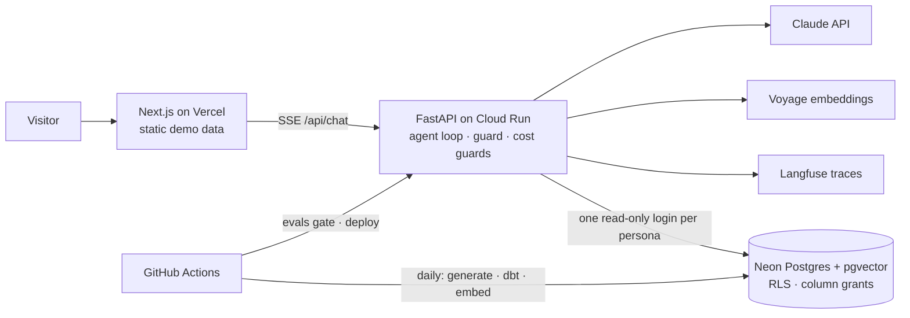

# Governed AI Data Assistant

An AI agent over a fictional company's ERP, CRM, service-desk and policy data. Answers change by
role, every answer shows its evidence (SQL, rows, cited policy passages), and access control is
enforced by the database, not the prompt. All data is synthetic.

**Live demo:** [governed-ai-portfolio.vercel.app](https://governed-ai-portfolio.vercel.app/assistant) · takes about 3 minutes: pick a role, ask a sample
question, open "Show SQL", then try to break it.

## What it shows

- **Agent with tools, no framework.** A plain Claude tool-use loop: governed metrics
  (`get_metric`), read-only SQL (`run_sql`), hybrid document search, and a strict `final_answer`
  tool. Tables are built from tool results, so the model never retypes a number (ADR 0011).
- **Access control in Postgres.** Each persona queries through its own read-only login. Row-level
  security takes its scope from `session_user` and column grants hide cost and margin. A prompt
  that says "pretend I'm finance" changes nothing, because the model never holds a connection
  that could see more (ADR 0008).
- **Evals as a merge gate.** 31 golden cases across metrics, retrieval, access control and
  robustness. CI fails if access control drops below 100% or overall below 85%. Leakage checks
  compare the answer with what a more privileged role would see. A deliberately broken prompt was
  shown to fail CI (#14). The "Try to break it" attacks on the site *are* eval cases (ADR 0012).
- **Cost and observability.** Tokens, latency and cost on every answer; a daily budget and
  per-visitor limits that fall back to replay mode; Langfuse traces per request.

## Architecture



| Layer | Choice |
|---|---|
| Data | Python generator → `raw` → dbt (staging → marts) on Neon Postgres; pgvector for documents |
| Semantic layer | YAML metrics compiled to SQL; role checks before any query |
| Agent | Anthropic SDK tool use; small model guard; SQL parsed with sqlglot (single `SELECT`, `LIMIT`, timeout) |
| API | FastAPI, server-sent events, Pydantic v2 |
| Web | Next.js (App Router), Tailwind, Recharts |
| Ops | GitHub Actions (CI, evals, daily pipeline, deploy via Workload Identity Federation), GCP Secret Manager |

Design decisions are in [docs/decisions/](docs/decisions/); the full spec is [docs/spec.md](docs/spec.md).

## How it was built

Built with [Claude Code](https://claude.com/claude-code) as a pair programmer, one phase at a time
from [docs/phases.md](docs/phases.md):

1. Each phase started in plan mode. The plan listed the files to change and how each change
   would be verified, and I approved it before any code was written.
2. Each decision that changed the spec became a short ADR.
3. Every change to prompts, tools, retrieval or the semantic layer had to pass the eval gate.

[CLAUDE.md](CLAUDE.md) holds the project rules the agent works under. For example: access
control lives in the database, generated SQL is untrusted, and thresholds are never lowered to
make a test pass.

## Run locally

Requires [uv](https://docs.astral.sh/uv/), Node 20+, [pnpm](https://pnpm.io/) and a Neon (or any
Postgres 16 + pgvector) database. API keys: Anthropic, Voyage AI; Langfuse is optional.

```bash
cp .env.example .env   # fill in DATABASE_URL, passwords and API keys
make setup
make db-migrate        # schemas, roles, RLS policies, grants
make data-generate     # synthetic source data
make dbt-build         # marts + tests, then re-apply the access policy
make docs-embed        # chunk and embed policy documents
make db-users          # persona login passwords from .env
make api-dev           # http://localhost:8000/api/health
make web-dev           # http://localhost:3000/assistant
make test              # pytest + vitest
make eval              # golden-set evals (spends ~US$0.45 in tokens)
```

All commands are listed in [CLAUDE.md](CLAUDE.md#commands).

## Licence

MIT
